# 6주차 실습 기록 — 입력한 데이터를 저장하기

**실습 날짜:** 2026.11.06

**사용 기술:** Java 21, Spring Boot 3.5.0, Spring Data JPA

**진행 범위:** Spring Boot 실습 1~3, 필수 미션

5주차에는 이메일과 닉네임 중복을 확인하고 회원별 평점을 조회하는 API를 만들었다. 이번에는 사용자가 입력한 회원 정보와 평점을 저장할 수 있도록 회원가입, 평점 등록·수정·삭제 기능을 추가했다.

캡처할 때는 `18080` 포트로 Spring 서버를 따로 실행하고 H2 메모리 DB를 사용했다. 아래 이미지는 이 서버에 실제 HTTP 요청을 보내서 받은 응답을 기록 화면으로 띄운 뒤 캡처한 것이다. Postman이나 MySQL에서 실행한 결과는 아니다.

## 1. 실습 1 — 회원가입 API 만들기

### 요청 DTO에서 입력값 검사하기

회원가입 요청을 받는 `SignUpRequest`를 만들고 각 필드에 검증 조건을 붙였다. 컨트롤러에서는 `@Valid`를 붙여서 조건에 맞지 않는 요청이 서비스로 넘어가기 전에 걸러지도록 했다.

| 입력값 | 확인한 조건 |
| --- | --- |
| 이메일 | 비어 있지 않은지, 이메일 형식인지, 254자 이하인지 |
| 닉네임 | 비어 있지 않은지, 2~12자인지 |
| 비밀번호 | 8자 이상인지, 대문자·소문자·숫자·특수문자(`!@#$%^&*`)가 모두 있는지 |

비밀번호에는 bcrypt가 받을 수 있는 길이도 적용했다. 한글은 한 글자가 여러 바이트이기 때문에, 글자 수가 아니라 UTF-8 기준 72바이트 이하인지 확인했다.

### 비밀번호를 해시해서 저장하기

`spring-security-crypto` 의존성을 추가하고 `BCryptPasswordEncoder`를 빈으로 등록했다. 회원가입 서비스에서는 이메일과 닉네임 중복을 먼저 검사하고, 통과하면 비밀번호를 해시해서 저장했다.

```java
Member member = Member.builder()
        .email(request.email())
        .password(passwordEncoder.encode(request.password()))
        .nickname(request.nickname())
        .build();
```

응답에는 `Member` 엔티티를 그대로 넣지 않고 `MemberResponse`를 사용했다. 이 DTO에는 `memberId`, `email`, `nickname`만 있어서 비밀번호와 비밀번호 해시가 응답에 들어가지 않는다. 저장된 해시는 자동 테스트에서 길이가 60자인지, `matches()`로 원래 비밀번호와 일치하는지도 확인했다.

### 회원가입 성공 확인

`umc@example.com`, `Umc!1234`, `moviefan`으로 요청했다. `201` 응답이 왔고, 생성된 회원 ID는 1이었다. 응답의 `result`에 비밀번호가 없는 것도 확인했다.

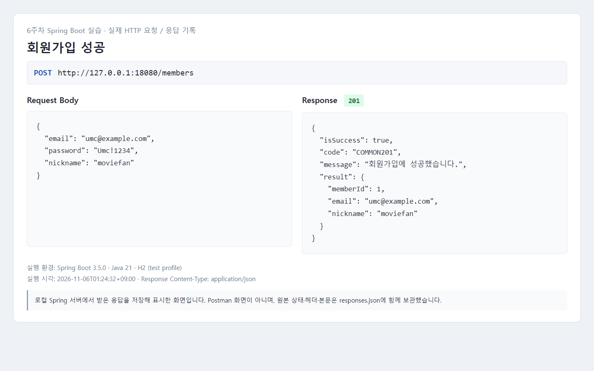

### 잘못된 이메일로 요청하기

이메일만 `not-email`로 바꿔서 요청했다. 이번에는 `400`과 함께 이메일 형식이 올바르지 않다는 메시지가 왔다.

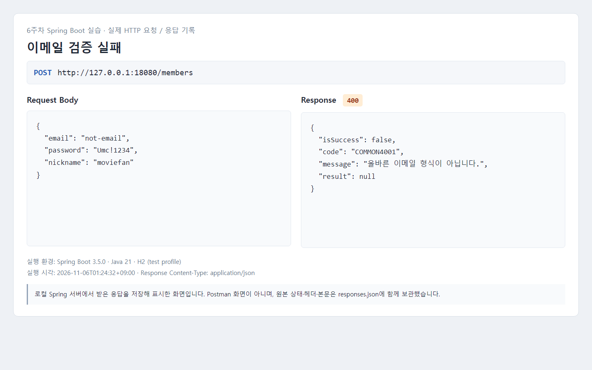

### 같은 이메일로 다시 가입하기

이미 가입한 이메일을 그대로 두고 닉네임만 바꿔서 요청했다. 중복 이메일은 `409`로 처리되는 것을 확인했다.

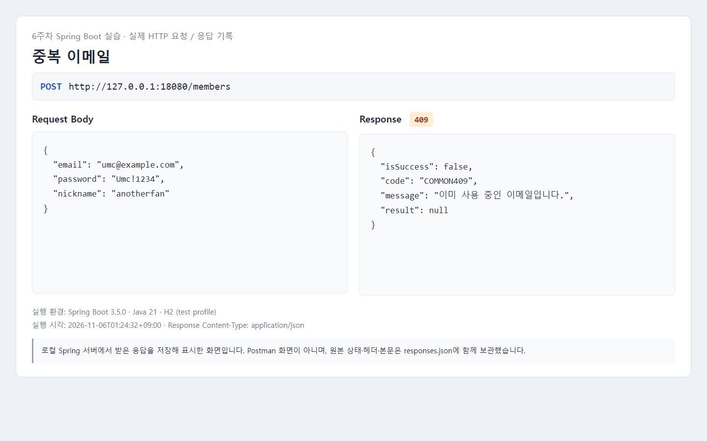

관련 코드: [SignUpRequest](../src/main/java/com/umc/movie/dto/SignUpRequest.java), [MemberService](../src/main/java/com/umc/movie/service/MemberService.java), [MemberController](../src/main/java/com/umc/movie/controller/MemberController.java), [PasswordConfig](../src/main/java/com/umc/movie/config/PasswordConfig.java)

## 2. 실습 2 — 실패 응답 형식 맞추기

성공 여부에 따라 JSON 모양이 달라지면 응답을 사용하는 쪽에서 매번 다르게 처리해야 한다. 그래서 새로 만든 쓰기 API는 `ApiResponse<T>`를 사용해서 아래 네 가지 필드를 보내도록 했다.

| 필드 | 의미 |
| --- | --- |
| isSuccess | 요청이 성공했는지 |
| code | 성공 또는 오류를 구분하는 코드 |
| message | 처리 결과를 설명하는 메시지 |
| result | 성공 결과. 실패할 때는 null |

컨트롤러마다 예외를 처리하는 대신 `@RestControllerAdvice`에서 한 번에 처리했다. DTO 검증 실패는 `400`, 중복 요청은 `409`, 다른 회원의 평점 변경은 `403`, 없는 데이터는 `404`로 응답한다. 잘못된 JSON이나 숫자가 아닌 경로 값도 같은 오류 형식을 사용한다.

DB의 UNIQUE 제약도 유지했다. 서비스에서 중복을 검사하더라도 거의 동시에 들어온 요청은 둘 다 검사를 통과할 수 있기 때문이다. DB에서 제약 위반이 발생하는 경우에도 전역 예외 처리에서 `409` 응답으로 바꿨다.

삭제 성공은 `204 No Content`이므로 응답 본문을 보내지 않는다. 5주차에 만들었던 조회 API의 정상 응답은 워크북 예제처럼 기존 형태를 유지했다.

관련 코드: [ApiResponse](../src/main/java/com/umc/movie/dto/ApiResponse.java), [GlobalExceptionHandler](../src/main/java/com/umc/movie/controller/GlobalExceptionHandler.java)

## 3. 실습 3 — 평점 등록·수정·삭제하기

평점 등록용 DTO에는 `movieId`, `score`, `comment`를 넣었다. `movieId`는 양의 정수, `score`는 1~5의 정수로 제한했고, 후기는 선택 사항으로 두되 500자까지만 입력할 수 있게 했다. 수정용 DTO에는 바꿀 수 있는 점수와 후기만 넣었다.

정수로 받아야 하는 값에 소수가 들어오지 않도록 `application.yaml`에는 `accept-float-as-int: false`도 설정했다.

### 평점 등록

1번 회원이 550번 영화에 5점과 후기를 남기도록 요청했다. 등록 결과는 `201`이었고, `result`에 평점 ID 1이 반환됐다. `movieId`는 TMDB에서 사용하는 영화 ID이므로 우리 DB의 영화 테이블을 조회하지는 않는다.

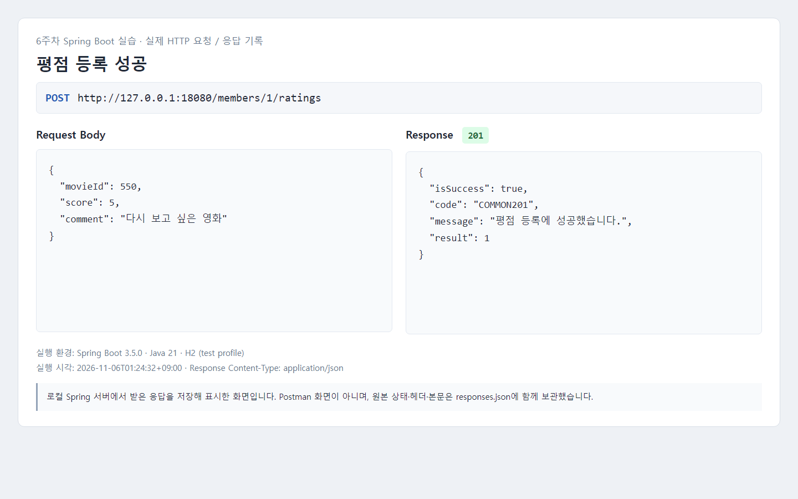

### 점수 범위와 중복 등록 확인

점수를 6으로 보내면 `400`이 반환됐다. 같은 회원이 이미 평점을 남긴 영화에 다시 등록하면 `409`가 반환됐다.

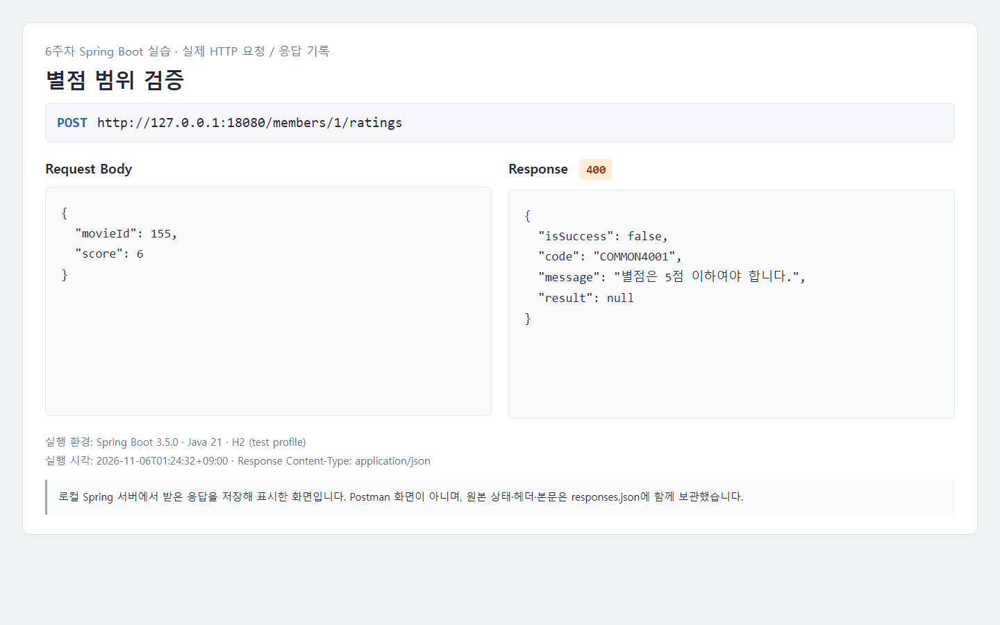

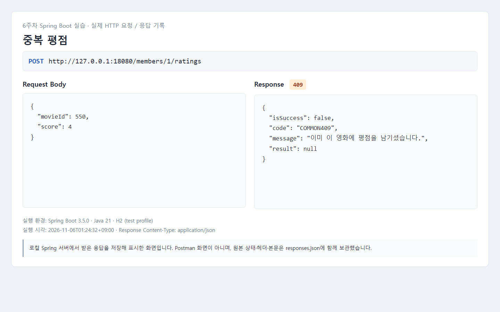

### 평점 수정

등록한 평점의 점수를 5점에서 4점으로 바꾸고 후기도 수정했다. 수정 요청은 `200`으로 처리됐다. 서비스의 트랜잭션 안에서 엔티티 값을 바꾸면 JPA 변경 감지로 DB에 반영된다.

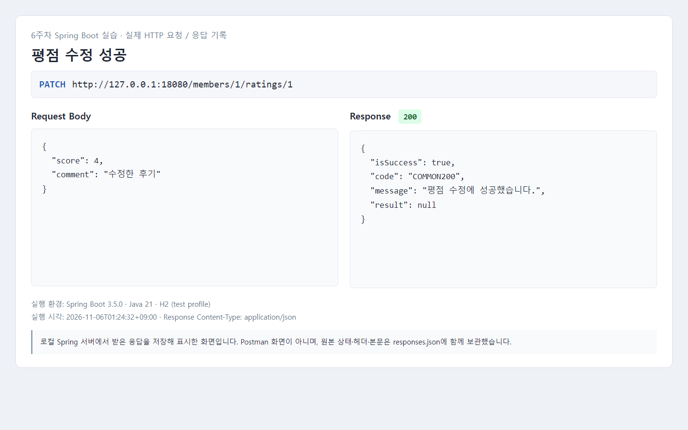

조회 API를 다시 호출해서 점수와 후기가 바뀐 것도 확인했다. 앞에서 중복 등록을 요청했지만 평점은 한 건만 조회됐다.

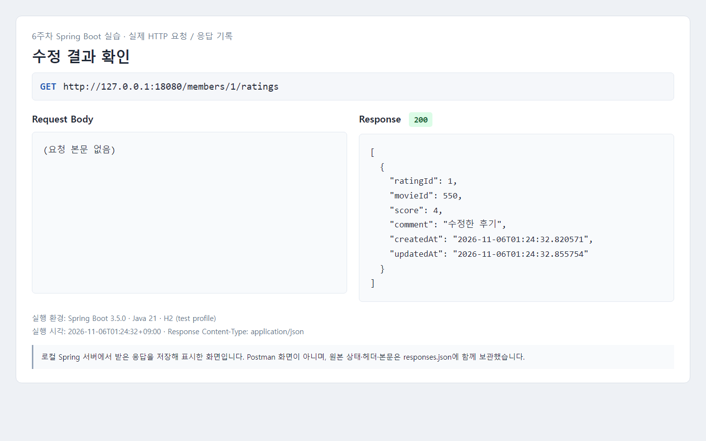

### 다른 회원이 수정하거나 삭제하려는 경우

수정과 삭제는 `findOwnedRating()`에서 평점이 있는지 먼저 확인하고, 작성자 ID와 요청의 `memberId`를 비교하도록 했다. 이 검사는 두 기능에서 공통으로 사용한다.

```java
if (!rating.getMember().getMemberId().equals(memberId)) {
    throw new ResponseStatusException(HttpStatus.FORBIDDEN,
            "본인이 작성한 평점만 수정하거나 삭제할 수 있습니다.");
}
```

2번 회원의 경로로 1번 회원의 평점을 수정하고 삭제해 봤다. 두 요청 모두 `403`으로 막혔고, 위의 재조회 결과에서도 원래 작성자가 수정한 4점이 유지됐다.

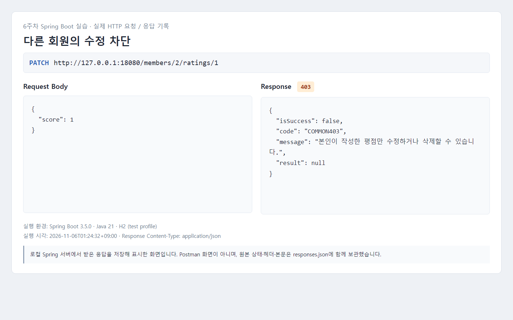

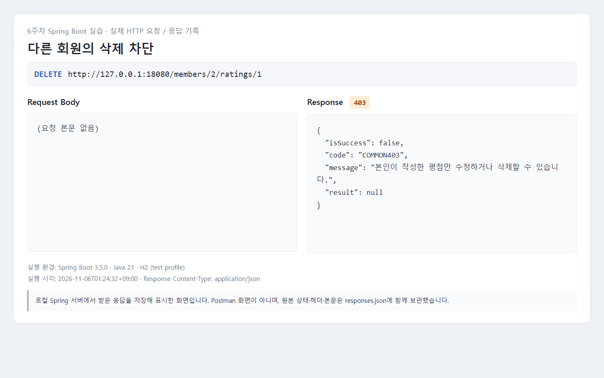

아직 로그인 기능을 붙이기 전이라 이번 실습에서는 경로에 있는 `memberId`로 비교했다. 토큰으로 실제 요청자를 확인하는 작업은 이후 실습에서 다룰 부분이다.

### 존재하지 않는 평점 요청

없는 평점 ID로 수정 요청을 보냈을 때는 `404`와 함께 존재하지 않는 평점이라는 메시지가 왔다.

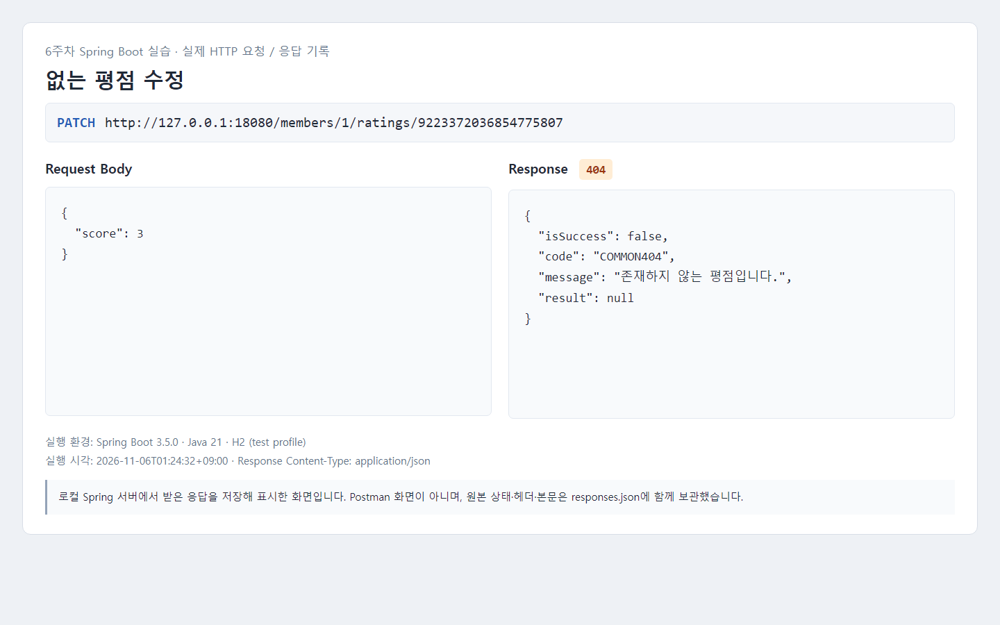

### 평점 삭제

작성자 본인의 경로로 삭제를 요청하니 `204`가 반환됐고, 응답 본문은 비어 있었다.

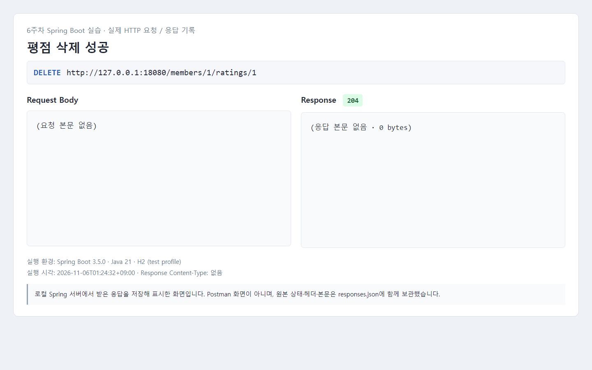

삭제한 평점에 다시 삭제 요청을 보내면 `404`가 반환됐다. 회원의 평점 목록도 빈 배열로 조회되어 삭제가 반영된 것을 확인했다.

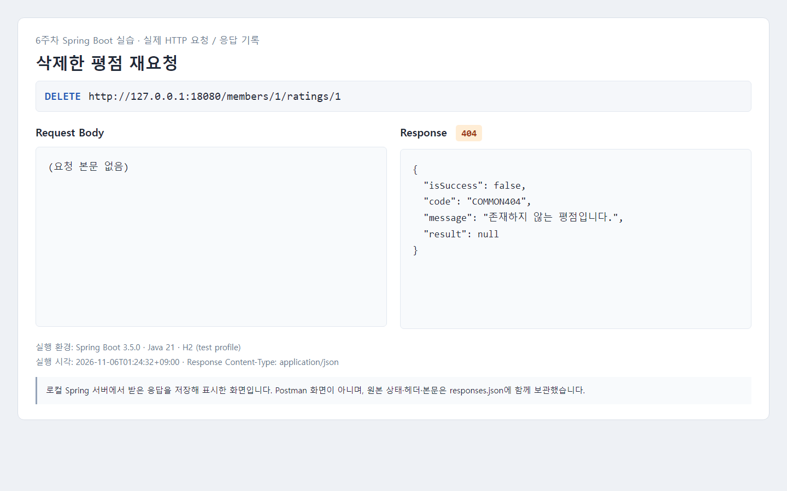

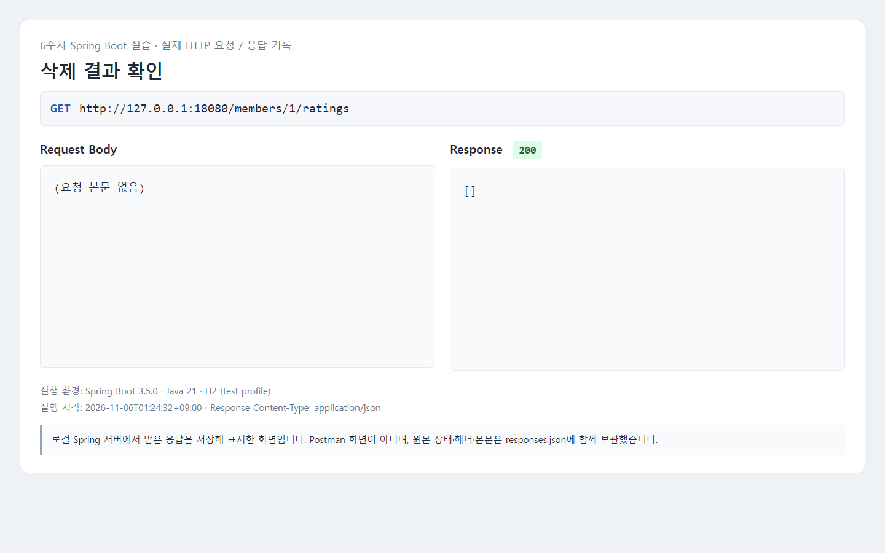

관련 코드: [RatingController](../src/main/java/com/umc/movie/controller/RatingController.java), [RatingService](../src/main/java/com/umc/movie/service/RatingService.java), [Rating](../src/main/java/com/umc/movie/entity/Rating.java), [RatingRepository](../src/main/java/com/umc/movie/repository/RatingRepository.java)

## 4. 필수 미션 정리

### API 명세

| 기능 | Method | 경로 | 요청 본문 | 성공 응답 |
| --- | --- | --- | --- | --- |
| 회원가입 | POST | `/members` | email, password, nickname | 201, 회원 정보 |
| 평점 등록 | POST | `/members/{memberId}/ratings` | movieId, score, comment(선택) | 201, ratingId |
| 평점 수정 | PATCH | `/members/{memberId}/ratings/{ratingId}` | score, comment(선택) | 200, result는 null |
| 평점 삭제 | DELETE | `/members/{memberId}/ratings/{ratingId}` | 없음 | 204, 본문 없음 |

### 확인한 내용

- [x] 회원가입 입력값 검증, bcrypt 저장, 응답에서 비밀번호 제외
- [x] 평점 등록·수정·삭제 구현
- [x] 잘못된 입력 400, 중복 회원·평점 409
- [x] 다른 회원의 수정·삭제 403, 없는 평점 404
- [x] 점수 범위와 후기 길이 검증
- [x] 삭제 성공 시 204와 빈 본문 확인
- [x] 요청·응답 캡처와 핵심 코드 정리

`./gradlew.bat test --no-daemon`으로 자동 테스트도 실행했다. 기본 기동 테스트 1건과 API 통합 테스트 36건으로 **총 37건이 통과했고 실패는 없었다.** 위의 실제 HTTP 요청 15건도 예상한 상태 코드와 일치했다.

DB 제약 테스트에서는 사전 중복 검사만 중복을 놓치도록 설정한 뒤 실제 H2 DB의 UNIQUE 제약이 저장을 막는지 확인했다. 실제 동시 요청 부하 테스트를 한 것은 아니다. 자동 테스트와 이번 캡처 모두 H2 기준이므로 MySQL에서도 같은 설정으로 동작하는지는 별도 확인이 필요하다.

테스트 코드: [WritingApiIntegrationTests](../src/test/java/com/umc/movie/WritingApiIntegrationTests.java)

수동 실행용 요청: [6주차-api.http](6주차-api.http)

캡처 원본 응답: [responses.json](evidence/week6/responses.json)

## 5. 트러블슈팅 — Gradle 테스트 실행 시 접근 거부

### 이슈

처음 테스트를 실행했을 때 `FileNotFoundException`이 발생했다. 메시지에는 Gradle 캐시의 `gradle-9.8.2-bin.zip.lck` 파일과 접근 거부가 표시됐다.

### 문제

Gradle이 배포 파일을 준비하면서 잠금 파일을 열어야 하는데, 테스트 실행 환경에서 사용자 홈의 Gradle 캐시에 접근할 권한이 없었다. API 코드가 실행되기 전 단계에서 난 오류라서 컨트롤러나 서비스 코드를 고쳐도 해결되는 문제가 아니었다.

### 해결

Gradle 캐시에 접근할 수 있는 실행 권한으로 다시 테스트를 돌렸다. `JAVA_HOME`도 설치된 Java 21 경로로 지정했다. 다시 실행했을 때는 빌드가 정상적으로 진행됐고 테스트 37건도 통과했다.

이 오류에서는 파일 이름만 보고 잠금 파일부터 지우기보다, 어느 단계에서 실패했는지와 해당 경로에 쓸 수 있는 권한이 있는지 먼저 확인해야 한다고 정리했다.

## 캡처를 다시 만드는 방법

아래 작업은 별도의 H2 메모리 DB를 사용한다. 캡처를 다시 만들 때는 서버를 새로 실행해야 한다. 같은 서버에서 요청 스크립트를 두 번 실행하면 이미 가입한 회원 때문에 첫 요청부터 중복 오류가 난다.

1. Java 21 환경에서 `./gradlew.bat --init-script docs/tools/practice-server.init.gradle practiceServer --no-daemon`으로 서버를 실행한다.
2. 다른 터미널에서 `python docs/tools/capture-practice.py`를 실행해 실제 요청과 응답을 저장한다.
3. Chrome이 설치된 Windows에서 `python docs/tools/render-captures.py`를 실행해 기록 화면을 PNG로 캡처한다.

캡처 이미지, 기록 화면 HTML, 원본 응답 JSON은 `docs/evidence/week6`에 함께 보관했다.
